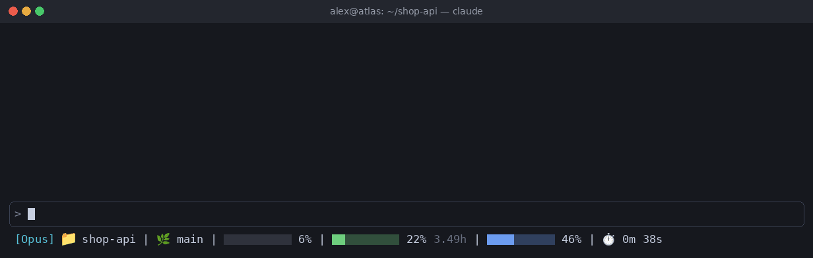

# claude-statusline

[Русский](README.ru.md) | **English**

A compact status line for [Claude Code](https://code.claude.com) showing the model, directory, git branch, context usage, rate limits and session time.



## What it shows

| Segment | Description |
| --- | --- |
| `[Opus]` | Current model |
| 📁 `dir` | Current working directory |
| 🌿 `branch` | Git branch (only inside a repository) |
| Context bar | Context window usage: grey, yellow at 70%, red at 90% |
| 5-hour bar | Session rate limit with time until reset: green, yellow at 60%, red at 90% |
| 7-day bar | Weekly rate limit: blue, orange at 50%, red at 80% |
| ⏱️ | Session duration |

The rate limit bars appear only when Claude Code provides rate limit data.

## Requirements

- Node.js
- A font with emoji support (on Ubuntu: `sudo apt install fonts-noto-color-emoji`)

## Installation

Download the script into your Claude config directory:

```sh
curl -o ~/.claude/statusline.js https://raw.githubusercontent.com/nearbyall/claude-statusline/main/statusline.js
```

Then add this to `~/.claude/settings.json`:

```json
{
  "statusLine": {
    "type": "command",
    "command": "node ~/.claude/statusline.js",
    "padding": 0
  }
}
```

The status line updates on the next refresh; restart Claude Code if it doesn't appear.
