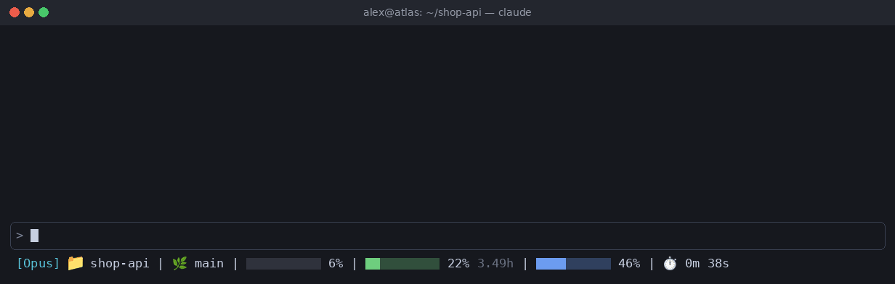

# claude-statusline

**Русский** | [English](README.md)

Компактная строка состояния для [Claude Code](https://code.claude.com): модель, папка, ветка git, заполненность контекста, лимиты и время сессии.



## Что показывает

| Сегмент | Описание |
| --- | --- |
| `[Opus]` | Текущая модель |
| 📁 `dir` | Текущая рабочая папка |
| 🌿 `branch` | Ветка git (только внутри репозитория) |
| Полоса контекста | Заполненность контекстного окна: серая, жёлтая от 70%, красная от 90% |
| 5-часовая полоса | Лимит сессии и время до сброса: зелёная, жёлтая от 60%, красная от 90% |
| 7-дневная полоса | Недельный лимит: синяя, оранжевая от 50%, красная от 80% |
| ⏱️ | Длительность сессии |

Полосы лимитов появляются, только если Claude Code передаёт данные о лимитах.

## Требования

- Node.js
- Шрифт с поддержкой эмодзи (в Ubuntu: `sudo apt install fonts-noto-color-emoji`)

## Установка

Скачайте скрипт в папку конфигурации Claude:

```sh
curl -o ~/.claude/statusline.js https://raw.githubusercontent.com/nearbyall/claude-statusline/main/statusline.js
```

Затем добавьте в `~/.claude/settings.json`:

```json
{
  "statusLine": {
    "type": "command",
    "command": "node ~/.claude/statusline.js",
    "padding": 0
  }
}
```

Строка состояния обновится при следующей перерисовке; если она не появилась, перезапустите Claude Code.
